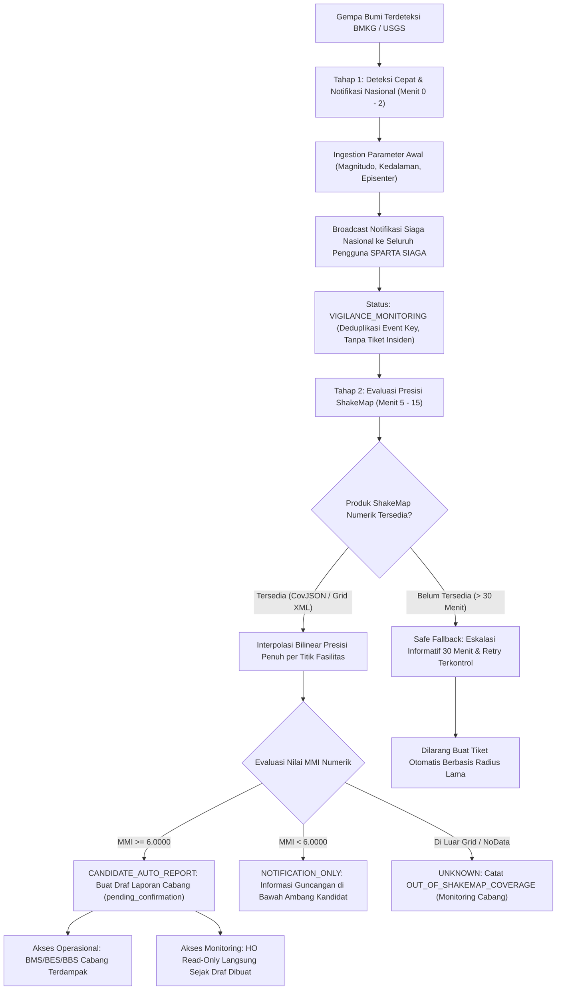

# SPARTA SIAGA: Earthquake Intensity Design Review

**Rancangan Arsitektur Final Integrasi ShakeMap MMI Dua Tahap sebagai Pengganti Model Radius Lingkaran**

- **Dokumen**: Final Technical Design Review (TDR)
- **Status Dokumen**: FINALIZED (READY FOR IMPLEMENTATION)
- **Branch Target**: `dev`
- **Referensi Hasil Validasi**: [`EARTHQUAKE_INTENSITY_POC_REPORT.md`](file:///c:/buildingprocess25/sparta-siaga/EARTHQUAKE_INTENSITY_POC_REPORT.md)
- **Artifact Komparasi**: [`data/poc/radius_vs_mmi_comparison.csv`](file:///c:/buildingprocess25/sparta-siaga/data/poc/radius_vs_mmi_comparison.csv)
- **Aturan Ketat**: Zero Em Dashes. Seluruh pemisah menggunakan tanda hubung `-` atau titik dua `:`.

---

## 1. Executive Summary & Status Finalisasi

Berdasarkan Proof of Concept (POC) yang telah tervalidasi pada branch `dev`, pemodelan radius lingkaran isotropik lama SPARTA SIAGA terbukti menghasilkan **59.0% overprediction** (161 dari 273 peringatan prioritas berada pada guncangan non-destruktif MMI IV-V). Sebaliknya, estimasi Modified Mercalli Intensity (MMI) dari produk ShakeMap resmi BMKG dan USGS mencerminkan kondisi guncangan permukaan secara lebih presisi dengan memperhitungkan mekanisme fokal, kedalaman hiposenter, atenuasi gelombang seismik, dan amplifikasi geologi tanah lokal ($V_{s30}$).

Dokumen ini merupakan **rancangan arsitektur final yang telah diselaraskan** untuk mengintegrasikan evaluasi intensitas gempa ShakeMap ke dalam siklus operasional SPARTA SIAGA. Seluruh kebijakan operasional, batasan visibilitas peran, protokol safe fallback, serta aturan penanganan data telah disepakati dan siap menjadi acuan langsung implementasi.

### Rangkuman Keputusan Desain Final:

1. **Notifikasi Siaga Nasional**: Notifikasi gempa Tahap 1 bersifat nasional tanpa pembatasan radius atau cabang, dengan deduplikasi kejadian ketat.
2. **Laporan Otomatis Cabang & Visibilitas HO Cepat**: Laporan gempa otomatis hanya dibuat untuk cabang terdampak, namun akun Head Office (HO) dapat melihatnya secara read-only sejak awal draf terbuat tanpa menunggu konfirmasi BnM Manajer.
3. **Visibilitas Bertahap Laporan Manual**: Laporan manual lokal tetap mempertahankan aturan keamanan Fase 1-4, yaitu baru terlihat oleh HO setelah adanya konfirmasi resmi awal dari BnM Manajer cabang.
4. **Ambang Kebijakan Kandidat Pemeriksaan (MMI >= VI)**: MMI VI adalah pemicu verifikasi fisik berkamera oleh PIC, bukan jaminan kerusakan. Sebaliknya, estimasi MMI < VI tidak boleh dinyatakan pasti aman atau bebas kerusakan.
5. **Safe Fallback & Eskalasi 30 Menit**: Jika ShakeMap belum tersedia, status ditetapkan sebagai `UNKNOWN`. Setelah 30 menit, sistem melakukan eskalasi informatif kepada Koordinator Cabang dan melanjutkan retry terkontrol tanpa pernah membuat laporan otomatis berdasarkan radius lama.
6. **Kebijakan Non-Pembatalan Tiket pada Revisi ShakeMap**: Jika revisi ShakeMap menurunkan nilai MMI, laporan yang sudah dibuat tidak boleh dibatalkan secara otomatis; perubahan dicatat dalam audit trail dan verifikasi lapangan tetap dilanjutkan.
7. **Pembedaan Resolusi Data**: Membedakan secara tegas ShakeMap numerik 2D berbasis koordinat presisi fasilitas ($lat, lon$) dengan laporan BMKG Dirasakan yang berbasis wilayah kota/kabupaten.

---

## 2. Arsitektur Pipeline Dua Tahap (Two-Stage Alert Pipeline)

Sistem memisahkan alur peringatan dini menjadi dua tahap sekuensial yang saling melengkapi:



### Rincian Tahap 1: Deteksi Cepat & Notifikasi Nasional (Menit 0 - 2)

- **Cakupan Pengguna**: **Bersifat Nasional**. Seluruh pengguna terautentikasi SPARTA SIAGA di seluruh cabang dan Head Office menerima informasi siaga gempa.
- **Tujuan**: Membangun kesadaran situasional dini (_instant situational awareness_) bagi seluruh jajaran manajemen dan operasional tanpa sekat wilayah.
- **Sumber Data**: BMKG Realtime Feed (`autogempa.json`) dan USGS Earthquake Notification Service (ENS).
- **Deduplikasi**: Notifikasi dikunci menggunakan `canonical_event_key` untuk mencegah pengiriman ganda pada revisi parameter awal gempa.
- **Batasan Ketat**: Pada tahap ini, sistem **TIDAK MEMBUAT** draf tiket insiden pada tabel `incidents`.

### Rincian Tahap 2: Evaluasi Presisi ShakeMap (Menit 5 - 15)

- **Cakupan Laporan**: **Khusus Cabang Terkait**. Draf tiket pemeriksaan lapangan hanya dibuat untuk toko/DC pada cabang yang fasilitasnya berada dalam zona intensitas tinggi.
- **Sumber Data**: Grid numerik resmi USGS ShakeMap CovJSON atau BMKG ShakeMap Grid XML.
- **Metode Komputasi**: Interpolasi bilinear float presisi penuh tanpa pemotongan desimal dini untuk menentukan apakah nilai berada pada $\text{MMI} \ge 6.0000$.
- **Hak Akses Langsung Head Office**: Khusus laporan otomatis hasil evaluasi ShakeMap ini, akun Head Office (HO) dapat langsung melihatnya pada dashboard monitoring secara _read-only_ sejak draf terbuat, guna memantau sebaran dampak gempa secara langsung.

---

## 3. Kebijakan Klasifikasi Tiga Status

```
+---------------------------+-------------------------------------------------------------------------+
| Status Keputusan          | Definisi Kriteria & Tindakan Operasional Sistem                         |
+---------------------------+-------------------------------------------------------------------------+
| NOTIFICATION_ONLY         | - Kriteria: Fasilitas berada dalam cakupan grid ShakeMap dengan         |
|                           |   estimasi MMI < 6.0000 (Skala I - V).                                  |
|                           | - Tindakan: Informasi disajikan sebagai notifikasi siaga informatif     |
|                           |   bahwa guncangan berada di bawah ambang aktivasi tiket otomatis.       |
|                           | - Batasan Bahasa: Dilarang menyatakan fasilitas 'pasti aman' atau       |
|                           |   'bebas kerusakan'. Toko tetap dapat melapor manual jika ada anomali.  |
|                           | - PIC cabang tidak dibebani kewajiban membuat berkas darurat otomatis.  |
+---------------------------+-------------------------------------------------------------------------+
| CANDIDATE_AUTO_REPORT     | - Kriteria: Fasilitas berada dalam cakupan grid ShakeMap dengan         |
|                           |   estimasi MMI >= 6.0000 (Skala VI - XII).                              |
|                           | - Tindakan: Membuat draf tiket insiden otomatis berstatus awal          |
|                           |   'pending_confirmation' dengan progress awal 0%.                       |
|                           | - Hak Akses: BMS/BES/BBS cabang terkait ditugaskan inspeksi fisik,      |
|                           |   sementara HO dapat memantau secara read-only sejak pembuatan draf.   |
+---------------------------+-------------------------------------------------------------------------+
| UNKNOWN                   | - Kriteria: Fasilitas berada di luar batas grid ShakeMap, data grid     |
|                           |   mengalami NoData/corrupt, atau produk ShakeMap belum tersedia.        |
|                           | - Tindakan: Dicatat sebagai 'OUT_OF_SHAKEMAP_COVERAGE' atau             |
|                           |   'SHAKEMAP_PENDING'. Draf tiket otomatis TIDAK dibuat.                |
|                           | - Sistem mengandalkan eskalasi informatif dan pemantauan mandiri cabang.|
+---------------------------+-------------------------------------------------------------------------+
```

### Landasan Ilmiah Ambang Batas MMI VI:

- Skala MMI VI (Strong Shaking) pada standar BMKG SIG Tingkat III merepresentasikan ambang batas potensi kerusakan fisik non-struktural (plester dinding rontok, rak toko bergeser, barang dagangan berjatuhan, retak rambut dinding).
- Nilai MMI $\ge 6.0000$ berfungsi sebagai **kandidat ambang pemeriksaan operasional** untuk mempercepat inspeksi personil spesialis. Bangunan dengan standar rekayasa gempa yang baik dapat bertahan utuh pada MMI VI, sehingga laporan otomatis berstatus kandidat hingga diverifikasi langsung dengan foto lapangan.
- Nilai MMI $< 6.0000$ merepresentasikan getaran ringan hingga sedang. Sistem tidak boleh melabeli kondisi ini sebagai jaminan mutlak ketiadaan kerusakan karena kualitas bangunan non-standar atau kondisi perabotan interior lokal tetap memiliki kerentanan minor.

---

## 4. Pembedaan Sumber Data: ShakeMap Numerik vs BMKG Dirasakan

Sistem menegaskan perbedaan teknis mendasar antara dua jenis data intensitas gempa:

```
+------------------------------------+------------------------------------+
| ShakeMap Numerik (USGS / BMKG)     | Laporan BMKG Dirasakan             |
+------------------------------------+------------------------------------+
| Karakteristik:                     | Karakteristik:                     |
| - Format: CovJSON / Grid XML 2D    | - Format: String Teks Makroseismik |
| - Resolusi: 1 - 3 km per sel grid  | - Resolusi: Tingkat Kota/Kabupaten |
| - Tipe Nilai: Desimal Kontinu MMI  | - Tipe Nilai: Rentang Romawi       |
| - Penentuan: Berbasis Titik Presisi| - Penentuan: Agregasi Komunitas    |
|   Koordinat Fasilitas (Lat, Lon)   |   Wilayah Administrasi Luas        |
+------------------------------------+------------------------------------+
| Peran dalam SPARTA SIAGA:          | Peran dalam SPARTA SIAGA:          |
| - Sumber primer untuk interpolasi  | - Data pendukung kontekstual dan   |
|   bilinear per fasilitas/toko.     |   validasi silang kewilayahan.     |
| - Menentukan keputusan otomatis    | - Tidak digunakan untuk kalkulasi  |
|   (CANDIDATE_AUTO_REPORT vs        |   interpolasi titik koordinat      |
|   NOTIFICATION_ONLY).              |   individual toko/gudang.          |
+------------------------------------+------------------------------------+
```

Integrasi sistem membedakan kedua sumber ini secara arsitektural: ShakeMap numerik diproses oleh engine interpolasi spasial $O(1)$, sedangkan BMKG Dirasakan diproses oleh parser teks untuk memperkaya informasi kartu pemantauan wilayah kota pada peta bencana.

---

## 5. Mekanisme Safe Fallback & Protokol Eskalasi 30 Menit

Ketika data ShakeMap numerik belum dapat diakses, sistem menerapkan prinsip **Safe Fallback**:

```
                                  PROTOKOL SAFE FALLBACK

  Gempa Terjadi (Menit 0) ---> Status: SHAKEMAP_PENDING (Evaluasi: UNKNOWN)
                                     |
                                     +---> Polling Berkala (Menit 5, 10, 15, 20, 25)
                                     |
                                     v
  Menit 30: ShakeMap Belum Terbit?
  ---------------------------------------------------------------------------------
  1. ESKALASI INFORMATIF:
     Kirim Advisory Digest ke Koordinator Cabang (BMC/BEC/BBC) dan BnM Manajer:
     "Data intensitas ShakeMap belum tersedia (>30 mnt). Parameter awal: M 6.2 Kedalaman 10 km."

  2. RETRY TERKONTROL BERKELANJUTAN:
     Lanjutkan polling terjadwal setiap 15 menit hingga batas backfill 24 jam.

  3. LARANGAN KERAS RADIUS LAMA:
     Sistem DILARANG OTOMATIS membuat draf tiket massal menggunakan rumus radius lama.
     Koordinator Cabang dapat menginstruksikan inspeksi manual jika menerima laporan lokal.
```

### Prosedur Penanganan Kegagalan:

1. **Status Evaluasi Awal**: Selama berkas ShakeMap belum berhasil diunduh dan divalidasi, seluruh fasilitas pada area kejadian berstatus `UNKNOWN`.
2. **Eskalasi 30 Menit**: Apabila setelah 30 menit data ShakeMap belum tersedia, sistem memicu notifikasi eskalasi informatif kepada Koordinator Cabang dan BnM Manajer. Notifikasi ini memberikan ringkasan parameter gempa dan daftar toko terdekat dari episenter sebagai bahan koordinasi visual, tanpa membuat tiket insiden otomatis.
3. **Retry Terkontrol**: Worker tidak mematikan proses, melainkan beralih ke interval polling 15 menit hingga data resmi diterbitkan atau mencapai batas waktu backfill 24 jam.
4. **Pencegahan Tiket Palsu**: Larangan beralih ke rumus radius melingkar lama ditegakkan secara permanen untuk mencegah bangkitnya 59.0% tiket palsu.

---

## 6. Kebijakan Non-Pembatalan Tiket pada Revisi ShakeMap & Audit Trail

Penerbitan ShakeMap sering mengalami pembaruan versi (misalnya Version 1 terbit menit ke-8, Version 2 terbit menit ke-25 setelah ada penambahan sensor gempa).

### Kebijakan Penanganan Revisi:

1. **Revisi yang Menaikkan Intensitas ($MMI < 6.0 \rightarrow MMI \ge 6.0$)**:
   Sistem membuat draf laporan `CANDIDATE_AUTO_REPORT` baru secara idempotent untuk fasilitas terkait melalui fungsi `ensureEarthquakeReport`.
2. **Revisi yang Menurunkan Intensitas ($MMI \ge 6.0 \rightarrow MMI < 6.0$)**:
   > [!IMPORTANT]
   > **Prinsip Non-Pembatalan Otomatis:**
   > Jika revisi ShakeMap menurunkan nilai estimasi MMI menjadi di bawah 6.0, sistem **DILARANG MEMBATALKAN SECARA OTOMATIS** laporan yang sudah dibuat.
   - **Alasan Keselamatan**: Personil PIC lapangan mungkin sudah bergerak menuju lokasi atau bersiap melakukan pemeriksaan. Pembatalan sepihak berisiko mengabaikan kerusakan lokal aktual.
   - **Aksi Sistem**: Sistem mencatat riwayat penurunan intensitas ke dalam audit trail insiden (`timeline`), memperbarui data pada tabel `earthquake_facility_intensities`, dan menampilkan tanda informatif pada antarmuka PIC: _"Estimasi intensitas ShakeMap direvisi turun ke MMI [X.XX]"_.
   - **Penyelesaian**: Verifikasi fisik lapangan tetap diselesaikan oleh PIC. Keputusan akhir penutupan laporan tanpa kerusakan dilakukan secara resmi oleh BnM Manajer melalui tombol konfirmasi _'Tidak Ada Kerusakan'_ (`confirmed_safe`).

---

## 7. Matriks Hak Akses, Visibilitas HO, dan Isolasi Cabang

Sistem menegakkan batasan peran operasional dan aturan visibilitas laporan:

```
+---------------------------+-----------------------+-----------------------+-----------------------+
| Komponen / Fitur          | PIC Spesialis Cabang  | Koordinator & BnM     | Head Office (HO)      |
|                           | (BMS / BES / BBS)     | (BMC / BEC / BBC / BMM)| (Manajemen HO)        |
+---------------------------+-----------------------+-----------------------+-----------------------+
| Notifikasi Gempa Tahap 1  | Menerima & Melihat    | Menerima & Melihat    | Menerima & Melihat    |
| (Vigilance Broadcast)     | Secara Nasional       | Secara Nasional       | Secara Nasional       |
+---------------------------+-----------------------+-----------------------+-----------------------+
| Laporan Gempa Otomatis    | Melihat & Mengisi     | Memeriksa, Konfirmasi | Memantau Read-Only    |
| (CANDIDATE_AUTO_REPORT)   | Tiket Cabang Terkait  | & Approval Cabangnya  | Langsung Sejak Dibuat |
+---------------------------+-----------------------+-----------------------+-----------------------+
| Laporan Gempa Manual      | Membuat & Mengisi     | Memeriksa & Memberi   | Baru Terlihat SETELAH |
| (report_origin = 'manual')| Tiket Cabang Terkait  | Konfirmasi Awal       | Konfirmasi Awal BnM   |
+---------------------------+-----------------------+-----------------------+-----------------------+
| Eksekusi Approval & Close | Tidak Berwenang       | Koordinator Review &  | Tidak Berwenang       |
| Laporan Insiden           |                       | BnM Manajer Case Close| (Strictly Read-Only)  |
+---------------------------+-----------------------+-----------------------+-----------------------+
```

### Penjelasan Khusus Aturan Visibilitas Head Office (HO):

1. **Laporan Gempa Otomatis**: HO dapat melihat draf laporan otomatis sejak pertama kali dibuat oleh sistem, karena pemicunya adalah data resmi BMKG/USGS yang bersifat objektif. Hal ini memungkinkan HO memantau eskalasi dampak bencana secara real-time nasional.
2. **Laporan Manual Cabang**: HO baru dapat melihat laporan manual setelah BnM Manajer memberikan konfirmasi awal (`confirmed_affected` atau `confirmed_safe`). Ini mempertahankan prinsip keamanan Fase 1-4 untuk menyaring laporan manual lokal yang belum divalidasi oleh pimpinan cabang.

---

## 8. Spesifikasi Teknis Basis Data & API

### A. Skema Tabel Basis Data

#### 1. Tabel `earthquake_shakemaps`

Menyimpan riwayat berkas dan versi ShakeMap numerik:

```sql
CREATE TABLE IF NOT EXISTS earthquake_shakemaps (
    id UUID PRIMARY KEY DEFAULT gen_random_uuid(),
    canonical_event_id VARCHAR(64) NOT NULL,
    source_provider VARCHAR(32) NOT NULL, -- 'USGS' | 'BMKG'
    version_number INTEGER NOT NULL DEFAULT 1,
    product_type VARCHAR(32) NOT NULL, -- 'covjson' | 'grid_xml'
    grid_bounds_x_min DOUBLE PRECISION NOT NULL,
    grid_bounds_x_max DOUBLE PRECISION NOT NULL,
    grid_bounds_y_min DOUBLE PRECISION NOT NULL,
    grid_bounds_y_max DOUBLE PRECISION NOT NULL,
    grid_num_x INTEGER NOT NULL,
    grid_num_y INTEGER NOT NULL,
    max_mmi DOUBLE PRECISION NOT NULL,
    checksum_sha256 VARCHAR(64) NOT NULL,
    storage_path VARCHAR(255) NOT NULL,
    evaluation_status VARCHAR(32) NOT NULL DEFAULT 'PENDING',
    received_at TIMESTAMPTZ NOT NULL DEFAULT NOW(),
    evaluated_at TIMESTAMPTZ,
    error_message TEXT,
    CONSTRAINT uq_event_source_version UNIQUE (canonical_event_id, source_provider, version_number)
);

CREATE INDEX IF NOT EXISTS idx_shakemaps_event ON earthquake_shakemaps(canonical_event_id);
```

#### 2. Tabel `earthquake_facility_intensities`

Menyimpan riwayat evaluasi presisi float per fasilitas dan audit versinya:

```sql
CREATE TABLE IF NOT EXISTS earthquake_facility_intensities (
    id UUID PRIMARY KEY DEFAULT gen_random_uuid(),
    shakemap_id UUID NOT NULL REFERENCES earthquake_shakemaps(id) ON DELETE CASCADE,
    canonical_event_id VARCHAR(64) NOT NULL,
    facility_kind VARCHAR(16) NOT NULL, -- 'STORE' | 'FACILITY'
    facility_id VARCHAR(64) NOT NULL,
    facility_code VARCHAR(32) NOT NULL,
    branch VARCHAR(64) NOT NULL,
    latitude DOUBLE PRECISION NOT NULL,
    longitude DOUBLE PRECISION NOT NULL,
    distance_km DOUBLE PRECISION NOT NULL,
    mmi_raw DOUBLE PRECISION, -- Presisi penuh unrounded float
    mmi_rounded NUMERIC(4, 2), -- 2 desimal display
    mmi_roman VARCHAR(8) NOT NULL,
    decision_policy VARCHAR(32) NOT NULL, -- 'CANDIDATE_AUTO_REPORT', 'NOTIFICATION_ONLY', 'UNKNOWN'
    discrepancy_vs_radius VARCHAR(32) NOT NULL, -- 'CONCORDANT_HIGH_RISK', 'CONCORDANT_LOW_RISK', 'RADIUS_OVERPREDICTION_VS_MMI', 'OUT_OF_SHAKEMAP_COVERAGE'
    shakemap_version INTEGER NOT NULL DEFAULT 1,
    incident_id VARCHAR(64) REFERENCES incidents(id) ON DELETE SET NULL,
    evaluated_at TIMESTAMPTZ NOT NULL DEFAULT NOW(),
    CONSTRAINT uq_shakemap_facility_version UNIQUE (shakemap_id, facility_kind, facility_id, shakemap_version)
);

CREATE INDEX IF NOT EXISTS idx_facility_intensities_lookup ON earthquake_facility_intensities(canonical_event_id, branch);
```

### B. Desain Kontrak Endpoint API

1. **`GET /api/earthquakes/[id]/shakemap`**:
   - Menampilkan status ketersediaan grid ShakeMap, versi terbaru, dan ringkasan jumlah fasilitas per kategori keputusan.
2. **`POST /api/earthquakes/[id]/evaluate`**:
   - Endpoint internal worker berproteksi token daemon untuk memicu kalkulasi batch saat berkas ShakeMap baru diunduh.
3. **`GET /api/incidents/[id]/intensity`**:
   - Menampilkan riwayat MMI presisi, nomor versi ShakeMap yang mendasari, dan catatan audit revisi pada detail insiden.

---

## 9. Analisis Ketidakpastian Saintifik & Batasan Model

SPARTA SIAGA secara konsisten mengedepankan transparansi teknis:

1. **Estimasi Model, Bukan Bukti Fisik**: Nilai ShakeMap MMI adalah estimasi matematis gelombang permukaan, bukan sensor kerusakan pondasi. Penetapan status kerusakan riil wajib mengandalkan inspeksi visual lapangan PIC.
2. **Ketidakpastian Atenuasi (GMPE)**: Rumus empiris atenuasi gelombang memiliki deviasi standar $\sigma \approx 0.5 - 0.7$ MMI.
3. **Proxy Geologi $V_{s30}$**: Estimasi amplifikasi tanah turunan topografi global memiliki potensi perbedaan pada cekungan aluvial tebal (seperti Cekungan Bandung atau dataran pantai Jakarta).
4. **Variasi Kerapatan Sensor**: Akurasi ShakeMap di Jawa-Bali sangat tinggi berkat kerapatan sensor BMKG, namun memiliki ketidakpastian lebih lebar di kepulauan terpencil dengan stasiun seismograf yang lebih jarang.

---

## 10. Kriteria Penerimaan Final (Acceptance Criteria)

Pelaksanaan implementasi modul wajib memenuhi 8 kriteria penerimaan berikut:

- [ ] **AC-01 (National Alert Broadcast)**: Notifikasi siaga gempa Tahap 1 terkirim secara nasional ke seluruh pengguna berwenang dalam waktu $< 2$ menit dengan deduplikasi berbasis `canonical_event_key` tanpa membuat tiket insiden.
- [ ] **AC-02 (Strict Candidate Threshold & Honest Copy)**: Fasilitas dengan estimasi MMI $\ge 6.0000$ dibuatkan draf laporan `CANDIDATE_AUTO_REPORT`, sedangkan MMI $< 6.0000$ dialihkan ke `NOTIFICATION_ONLY` tanpa klaim bahwa lokasi pasti aman atau bebas kerusakan.
- [ ] **AC-03 (Full Precision Decision Guard)**: Evaluasi ambang $6.0000$ dilakukan pada nilai float murni. Nilai $5.9999$ terbukti menghasilkan `NOTIFICATION_ONLY` dalam pengujian unit otomatis.
- [ ] **AC-04 (Safe Fallback & 30-Minute Escalation)**: Jika ShakeMap belum tersedia, status fasilitas adalah `UNKNOWN`. Setelah 30 menit, sistem mengirimkan notifikasi eskalasi informatif dan melanjutkan retry terkontrol tanpa pernah membuat laporan otomatis berdasarkan radius lama.
- [ ] **AC-05 (Deterministic Out of Coverage)**: Fasilitas di luar bounding box grid ShakeMap berstatus `UNKNOWN` (`OUT_OF_SHAKEMAP_COVERAGE`) dan tidak dianggap aman secara prematur.
- [ ] **AC-06 (Dual Visibility Policy)**: Laporan gempa otomatis dapat dipantau oleh akun HO secara read-only langsung sejak draf dibuat, sedangkan laporan manual lokal baru terlihat oleh HO setelah adanya konfirmasi resmi awal dari BnM Manajer.
- [ ] **AC-07 (Non-Cancellation on ShakeMap Downgrade)**: Jika revisi ShakeMap menurunkan estimasi MMI ke $< 6.0$, sistem mencatat perubahan pada audit trail dan mempertahankan laporan untuk diverifikasi fisik oleh PIC lapangan.
- [ ] **AC-08 (Spatial Resolution Distinction)**: Sistem membedakan secara tegas pemrosesan grid numerik ShakeMap per koordinat toko dari laporan BMKG Dirasakan yang berbasis agregasi wilayah kota.

---

## 11. Rekapitulasi Keputusan Final Arsitektur

Dokumen ini secara resmi menutup seluruh opsi terbuka sebelumnya menjadi **tiga keputusan arsitektural final**:

1. **Keputusan Final 1 (Timeout Fallback & Eskalasi)**:
   Sistem menerapkan batas waktu tunggu **30 Menit**. Jika ShakeMap belum tersedia pada menit ke-30, sistem mengirimkan _Advisory Digest_ kepada Koordinator Cabang dan BnM Manajer, melanjutkan retry terjadwal setiap 15 menit, serta melarang keras pembuatan tiket otomatis dengan radius lama.
2. **Keputusan Final 2 (Kebijakan Revisi ShakeMap)**:
   Sistem **mempertahankan seluruh laporan yang telah dibuat** meskipun revisi ShakeMap menurunkan intensitas ke MMI $< 6.0$. Seluruh perubahan dicatat pada audit trail, verifikasi lapangan PIC tetap berlangsung, dan keputusan penutupan diserahkan kepada BnM Manajer.
3. **Keputusan Final 3 (Cakupan Notifikasi Siaga Awal)**:
   Notifikasi gempa Tahap 1 berstatus siaga awal **disiarkan secara nasional ke seluruh pengguna SPARTA SIAGA yang berwenang** di seluruh Indonesia dengan deduplikasi event ketat. Sementara itu, draf laporan operasional tetap terisolasi khusus cabang yang terdampak.
